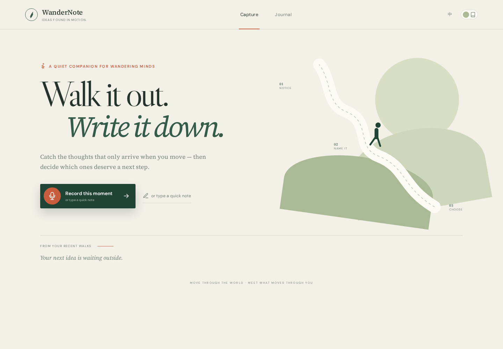

# WanderNote / 散步想法日记 MVP

> **Unlock your walking companion. Ideas found in motion.**  
> 解锁你的散步搭子。动中生静，于想法中洞见自己。

WanderNote 是一个端侧优先、移动优先的散步想法捕捉 App。语音默认在本机用 `faster-whisper` 转写；想法保存在本地 SQLite；DeepSeek 可用时负责轻量判断，不可用时明确降级为本地规则。用户始终可以覆盖判断。



## 已实现的 MVP 闭环

- **快速捕捉**：首页大按钮；浏览器 `MediaRecorder` 语音录制和文字快记；心情、场景、地点标签。
- **真实 STT**：`faster-whisper` base 模型本地转写，结果可编辑；可选 OpenAI `whisper-1` API 兜底。
- **行动判断**：DeepSeek 返回 `action / hold / emotion` 和不超过两句理由；失败时使用可辨识的本地规则结果。
- **人有最终决定权**：保存结果页和日记卡片都能手动改判断，数据库会记录 `verdict_source=user`。
- **回顾与整理**：时间线、判断筛选、全文搜索、多选导出 Markdown。
- **双语与双主题**：英文默认，可切中文；现代主题和暖色复古日记主题；桌面与手机响应式布局。

## 一键启动

要求：Node.js 20+、Python 3.11+、系统可用的 `ffmpeg`。

```bash
# 1. 前端依赖
cd web
npm install
cd ..

# 2. 后端环境
python3 -m venv .venv
source .venv/bin/activate
pip install -r server/requirements.txt

# 3. 可选：配置 DeepSeek（没有 key 也能以本地判断运行）
cp .env.example .env
# 编辑 .env，填入 DEEPSEEK_API_KEY
```

一条命令同时启动 API 与前端：

```bash
npm run dev
```

如需分别调试，也可以打开两个终端：

```bash
# Terminal A — API 与 SQLite
source .venv/bin/activate
uvicorn server.app:app --reload --host 0.0.0.0 --port 8000
```

```bash
# Terminal B — Vite（根目录运行）
npm run dev:web
```

浏览器打开 <http://localhost:5173>。Vite 已将 `/api` 代理到 `127.0.0.1:8000`。

> 浏览器麦克风只在安全上下文可用：桌面 `localhost` 可直接录音；手机通过局域网 IP 访问时需要 HTTPS（或 USB 端口转发为 localhost）。文字输入不受此限制。

## 环境变量

服务端优先读取进程环境变量，其次读取项目根 `.env`；在当前 director 环境中还会只读兜底到 `/mnt/d/hermes-agents/director/hermes-home/.env`。密钥不会复制进仓库或数据库。

| 变量 | 默认值 | 用途 |
|---|---|---|
| `JUDGMENT_PROVIDER` | `auto` | `auto` / `local`；auto 有 key 时调用 DeepSeek |
| `DEEPSEEK_MODEL` | `deepseek-v4-flash-vision-exp` | 想法分类模型 |
| `STT_PROVIDER` | `local` | `local` / `openai` |
| `WHISPER_MODEL` | `base` | faster-whisper 模型名；首次使用可能下载模型 |
| `WHISPER_DEVICE` | `cpu` | 有 CUDA 时可改为 `cuda` |
| `WHISPER_COMPUTE_TYPE` | CPU 为 `int8` | 本地推理精度/速度权衡 |
| `IDEA_DB_PATH` | `data/ideas.db` | SQLite 数据文件 |

如需使用 brief 给出的代理，在启动后端前设置：

```bash
export HTTPS_PROXY=http://172.20.224.1:7890
export HTTP_PROXY=http://172.20.224.1:7890
```

## 架构

```text
Mobile / Desktop browser
  ├─ MediaRecorder ── audio/webm ──> POST /api/transcribe
  │                                      ├─ faster-whisper (default, local)
  │                                      └─ OpenAI whisper-1 (optional)
  └─ Editable text + tags ─────────> POST /api/ideas
                                         ├─ DeepSeek judgment
                                         ├─ transparent local fallback
                                         └─ SQLite data/ideas.db

Journal <── search/filter/list ── GET /api/ideas
        └── human override ───── PATCH /api/ideas/:id/verdict
```

后端只使用标准库 `sqlite3`，没有 ORM 和迁移框架，适合当前单用户 MVP。音频上传限制 25 MB，转写临时文件完成后立即删除；数据库只保存文字与元数据。

## 验收与测试

```bash
# 后端闭环：创建 → 判断 → 列表/筛选 → 人工覆盖 → 搜索
pytest -q

# 前端生产构建
npm run build

# 健康检查（后端启动后）
curl http://127.0.0.1:8000/api/health
```

真实 STT 集成测试需要给一个真实 WAV 文件：

```bash
WANDERNOTE_STT_SAMPLE=/absolute/path/to/speech.wav pytest -q tests/test_stt.py
```

本次实现已用公开 JFK 16kHz WAV 实测本地 base 模型，得到：

```text
And so my fellow Americans, ask not what your country can do for you,
ask what you can do for your country.
```

DeepSeek 也已用真实 key/真实请求验证，返回 `action` 和一条针对测试想法的具体理由。自动化测试默认强制 `JUDGMENT_PROVIDER=local`，避免 CI 意外产生 API 费用；这不代表线上路径是 mock。

如要明确产生一次真实 API 请求并验证“保存 → DeepSeek 判断 → 搜索回顾 → 人工覆盖 → Markdown 生成”：

```bash
python3 scripts/verify_live_e2e.py
```

## 验收自查

| 项目 | 状态 | 证据/说明 |
|---|---|---|
| 前后端可启动 | ✅ | `npm run build` 通过；FastAPI lifespan/health 已验证 |
| 首页大按钮 | ✅ | “Record this moment / 记录此刻想法” |
| 真实语音转写 | ✅ | faster-whisper base + 真实 WAV；输出不是占位符 |
| 文字保存 | ✅ | `/api/ideas` + SQLite |
| 判断、理由、覆盖 | ✅ | DeepSeek 真实请求通过；PATCH 覆盖测试通过 |
| 时间线、筛选、搜索 | ✅ | 日记页 + API 参数测试 |
| Markdown 导出 | ✅ | 浏览器生成 UTF-8 `.md` 文件 |
| 中英 / 复古主题 / 移动端 | ✅ | UI 切换与 390px 截图已检查 |

## 演示截图

- [桌面首页](docs/screenshots/desktop-home.png)
- [语音捕捉面板](docs/screenshots/desktop-capture.png)
- [390px 手机首页](docs/screenshots/mobile-home.png)

截图由 `scripts/capture-ui.mjs` 从生产构建渲染。该脚本只用于视觉验收，需要单独提供 Playwright 模块路径；产品运行不依赖 Playwright。

## 已知限制与下一步

- 这是明确的单用户、本地优先 MVP：没有账号、同步、订阅和社交分享。
- 本地 Whisper 第一次加载模型会有数秒冷启动；CPU 录音越长等待越久。产品验证后可加后台任务和进度轮询。
- DeepSeek 不可达时不会阻止保存，但分类会标成 `local-fallback`；建议后续在 UI 加一个更显眼的离线状态提示。
- 手机真实录音部署必须配 HTTPS。若要公开测试，下一步优先加 Caddy/Cloudflare Tunnel，而不是先做账号系统。
